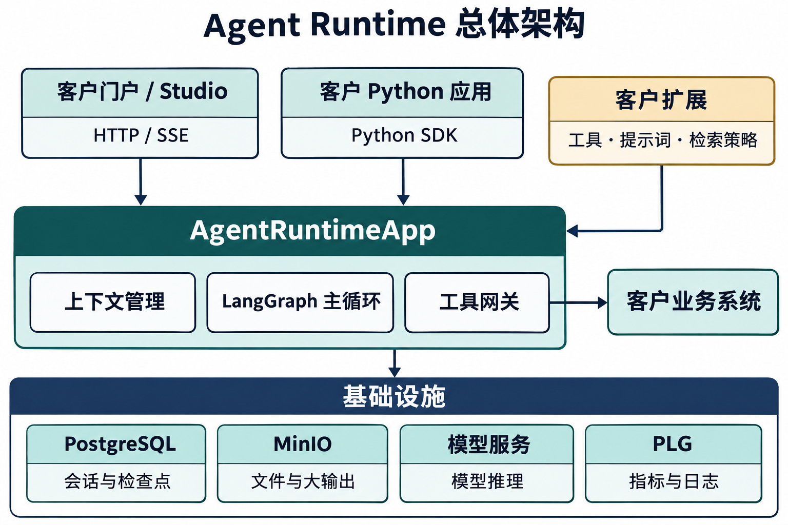
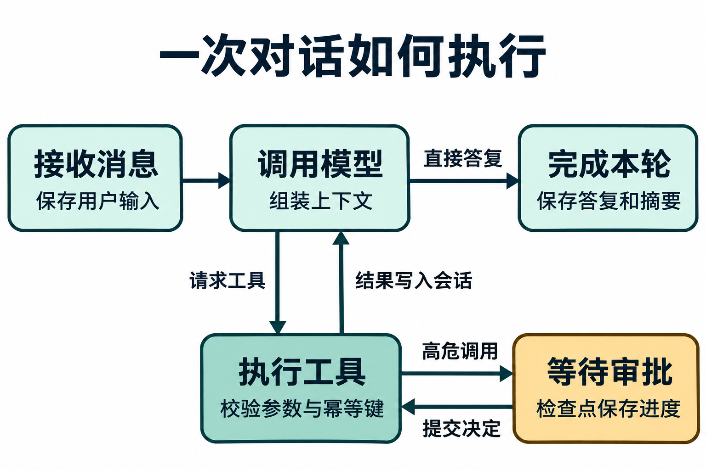

# Agent Runtime · 后端架构

客户代码决定 Agent 能办什么事。共享 SDK 负责一轮对话怎样运行、调用工具后怎样继续，以及中途暂停后从哪里恢复。Python 应用可以直接装配 SDK，参考 HTTP 服务则把同一条执行路径开放给 Studio 和客户门户。

[项目首页](../README.md) · [HTTP / SSE v1 契约](API.md) · [后端源码](agent_runtime/)

---

## 1. 总图、分层边界与装配生命周期

### 四层职责与依赖约定

| 层 | 负责什么 | 从哪里读代码 |
| --- | --- | --- |
| 接口 (`api/`) | 接收 HTTP 请求，解析身份，启动/恢复运行，通过 SSE v1 推流 | [api/main.py](agent_runtime/api/main.py) · [chat_stream.py](agent_runtime/api/chat_stream.py) |
| 内核 (`framework/`) | 装配模型与扩展，构建执行图，管理上下文预算、Run 状态机与工具网关 | [agent/app.py](agent_runtime/framework/agent/app.py) · [core/workflow.py](agent_runtime/framework/core/workflow.py) |
| 扩展 (`extensions/`) | 提供 RAG、Skills 标准扩展与客户业务工具；费用包演示查询 BI 与写回执 | [RAG](agent_runtime/extensions/rag/) · [Skills](agent_runtime/extensions/skills/) · [费用包](agent_runtime/extensions/customers/enterprise_expense/) |
| 基础设施 (`infra/`) | 适配 PostgreSQL + pgvector、MinIO 对象存储、LLM 服务与 PLG 观测 | [PG](agent_runtime/infra/pg/) · [OSS](agent_runtime/infra/oss/) · [LLM](agent_runtime/infra/llm/) · [PLG](agent_runtime/infra/plg/) |

**依赖方向与客户隔离原则：**
- 目标依赖方向为 `api -> extensions -> framework <- infra`：内核只依赖稳定契约与协议，基础设施适配内核契约，客户业务表、提示词与外部系统连接器封装在独立客户包内（不写入平台 `sql/` 或 `framework/`）。
- *当前工作树已知待收敛偏差*：① 示例表 `oa_approvals` 仍在 `sql/002_oss_and_kb.sql` 与 `infra/pg/sessions.py` 的删除逻辑中；② `infra/llm/mock.py` 直接导入费用演示脚本；③ `infra/pg/rag_repo.py` 导入 `extensions/rag/text_utils.py`；④ `AgentRuntimeApp.__init__` 懒导入默认 PG/PLG/Mock 实现。新增客户包请严格遵守上述隔离原则，避免继续向公共层写入业务代码。

### 启动装配 vs 每次执行

1. **启动装配（一次）**：`AgentRuntimeApp` 构造 → 注册不可变内置工具（`read` / `write` / `read_tool_output`）→ 加载自定义工具、子 Agent 与 `extensions`（`AGENT_EXTENSIONS` 支持外部独立 Python 包 `pkg.mod:Plugin`）→ **冻结 `ToolRegistry`**（运行期禁止篡改工具表）→ 执行幂等 `bootstrap_extensions()`（种子知识、默认 Skill）。
2. **每次执行（按请求）**：创建/校验会话 → 登记持久化 `agent_runs` → 写入用户消息并触发统一 LangGraph 执行图 → 流式推送 SSE v1 事件并按步落库 → 正常收敛或暂停等待审批恢复。

> **同进程运行边界**：客户 Python 插件与后端运行在同一进程内，应按业务代码同等级评审、打包与发布，更新后重启服务生效。

---

## 2. 一轮请求：模型决定下一步，Runtime 负责执行

以费用示例“核查差旅超标并发起审批”为例。Python SDK（`app.run_turn` / `app.resume_approval`）与 HTTP 服务共用以下单一 LangGraph `StateGraph` 执行图：

1. **组装上下文（`before_model`）**：读出历史摘要与摘要游标之后的消息，拼接当前轮尚未持久化的临时消息。预算超限时以**原子工具组**（`assistant(tool_calls)` + 对应全部 `tool` 结果）为单位从旧到新连续裁剪；若最新一组自身超窗则截断工具正文而非丢弃配对，避免模型看到孤立的 `tool_call`。[上下文组装](agent_runtime/framework/context/memory.py)
2. **执行工具（`tools_node` → `ToolGateway`）**：按 `RiskLevel` 分流（只读工具受限并行，写/高危工具串行），依次执行权限收窄校验、JSON Schema 参数校验、循环熔断、高危审批拦截、幂等抢占与超时控制。返回过大时将原文落 MinIO，仅把预览与 `ref_id` 放回上下文，由 `read_tool_output` 分页续读。[工具网关](agent_runtime/framework/tools/gateway.py)
3. **按步记录进度**：每批工具完成后，图节点以 `(thread_id, trace_id, step_key)` 幂等写入本批消息并推进 `persisted_count`。最终答复在 `finish` 节点落库后，再判断是否触发 `compact_after_agent` 推进摘要游标。[执行图](agent_runtime/framework/core/workflow.py)
4. **跨轮审批恢复**：`HIGH_RISK` 工具通过 LangGraph `interrupt()` 暂停，前端收到 `approval_required`。提交决定后，服务校验检查点挂起票据与运行状态，记录决定并以 `Command(resume=review_id)` 恢复同一检查点继续执行。[审批入口](agent_runtime/api/approvals.py) · [运行状态](agent_runtime/framework/core/runs.py)

---

## 3. 状态归属、存储分工与标识串联

核心标识关联：`request_id`（客户端请求关联标识，并参与写动作 `op_key` 计算；当前 HTTP 入口不按 `request_id` 去重）→ `run_id`（一次运行生命周期，受同会话活跃唯一约束保护）→ `trace_id`（单轮观测链路）→ `op_key`（基于会话、用户、请求、工具名与 `tool_call.id` 计算的写动作幂等键）→ `thread_id`（会话与 LangGraph 检查点归属）。

| 问题 | 去哪里查（存储层） | 关联键 / 前缀 |
| --- | --- | --- |
| 这次对话写入了哪些消息与摘要？ | PG：`agent_threads`、`session_messages`、`session_summaries` | `thread_id` |
| 当前在执行、等审批还是已取消？ | PG 业务状态：`agent_runs`、`tool_approvals`；LangGraph 断点：`checkpoints*` | `run_id` / `review_id` / `thread_id` |
| 同一个写动作是否执行过？ | PG：`tool_runs`（记录 `running`/`done`/`reconcile`、回执与结果引用） | `(tenant_id, op_key)` |
| 原始大输出、工作区、知识与 Skill 原文在哪？ | PG 存元数据与向量索引（`tool_outputs`、`workspace_files`、`rag_parents`/`rag_chunks`、`agent_skills`/`agent_skill_versions`）；MinIO 存不可变原文 | `outputs/`、`workspaces/`、`knowledge/`、`skills/` |
| 哪一步拖慢了响应？ | Prometheus（首 token / 工具状态）、Loki（结构化日志）、PG `agent_spans`（步骤耗时）、Grafana 看板 | `trace_id` |

**检查点与连接生命周期**：
- FastAPI `lifespan` 启动时打开 `psycopg_pool.ConnectionPool`（`PgOssStore`）、初始化 `AsyncPostgresSaver`、装配 `OpenAICompatibleProvider` 与后台日志推送协程，关闭时优雅刷盘并释放连接池。[启动与关闭](agent_runtime/api/main.py) · [PG 仓储](agent_runtime/infra/pg/postgres.py)
- 直接嵌入 Python SDK 时，默认检查点为进程内 `InMemorySaver`；需要跨进程或跨重启恢复审批时，应显式传入持久化 checkpointer（如 `AsyncPostgresSaver`）。Mock 模型仅替代推理服务，PostgreSQL 与 MinIO 仍全程参与执行。

---

## 4. 断连、取消、重放与故障窗口

| 情况 | 当前后端行为 | 客户开发 / 运维需要知道什么 |
| --- | --- | --- |
| 浏览器关闭或 SSE 消费过慢 | `publish_sse` 有限等待（0.5s），超时或断连后摘除推送队列，不再阻塞后台协程 | 后台运行可继续收敛并落库，不会锁死会话 409；回到页面查历史与状态，需主动停止时调用 Abort |
| 用户在一批工具执行中途取消 | `tools_node` 捕获 `CancelledError`（不吞 LangGraph 中断异常），同步刷盘本批已完成结果并为未完成调用补 `[cancelled]`；`agent_runs` 不可逆置为 `cancelled`，拒绝迟到的审批恢复 | 已被下游业务系统受理的副作用仍需按业务规则补偿或人工核对 |
| 审批恢复触发节点重放 | 网关用 `(tenant_id, op_key)` 抢占；已完成写动作直接复用已存回执，避免重复扣款或重复提单 | 对接真实 OA / 工单时，务必透传 `ctx.op_key` 给下游做幂等防重 |
| 下游已受理但超时/中途取消（状态不确定） | 网关将 `tool_runs.status` 标记为 `reconcile` | 客户连接器需约定按 `op_key` 向外部系统查单对账的恢复手段 |
| 进程崩溃或首条消息写入前故障 | PG 保存业务运行态、LangGraph 保存节点级检查点，二者覆盖不同窗口；进程异常退出后活跃 `agent_runs` 目前需人工/超时回收 | 计划在后续版本补充 `start_run` 与首条消息的事务收敛及超时僵尸 Run 自动回收机制 |

---

## 5. 扩展契约：从费用示例换成客户项目

| 扩展协议 | 定位与适用场景 | 源码入口 |
| --- | --- | --- |
| `AgentPlugin` | 统一的能力包与客户业务打包入口（声明系统提示词、工具、子 Agent、受控中间件与前端元信息），支持 `extensions=[...]` 与 `AGENT_EXTENSIONS` 挂载 | [core/protocols.py](agent_runtime/framework/core/protocols.py) |
| `AgentMiddleware` | 受控生命周期切面（`extra_context` 纳入内核预算、`transform_user_input`、`on_before_model` 只读快照、`after_model`、`wrap_tool`、`after_turn`），不可破坏上下文裁剪与工具配对 | [core/middleware.py](agent_runtime/framework/core/middleware.py) |
| `LLMProvider` | 替换模型后端（默认 OpenAI 兼容流式 Provider 与脚本 Mock） | [infra/llm/provider.py](agent_runtime/infra/llm/provider.py) |
| `RAGStrategy` | 替换整条检索管线（默认内置 7 阶段混合检索，可无缝换接 Milvus / ES / 客户知识服务） | [extensions/rag/extension.py](agent_runtime/extensions/rag/extension.py) |

| 新客户需求 | 推荐接入方式 |
| --- | --- |
| 接入新业务系统（ERP / 工单 / OA） | 用 `@tool` 封装客户接口并标注 `RiskLevel`，通过独立客户包注册，由网关统一处理校验、超时、审批与幂等 |
| 更换知识库检索 | 保留内置 7 阶段 RAG 并替换 `EmbeddingClient` / `RerankClient`，或传入自定义 `RagExtension(strategy=...)` |
| 交付业务 SOP | 通过 `SkillsExtension` 发布版本化声明式文档与文本附件（拒绝可执行脚本），Agent 按需检索读取 |
| 接入现有门户前端 | 对接 [HTTP / SSE v1 契约](API.md)，与参考 Studio 共用同一后端与运行状态 |

---

## 6. 安全边界与可拔插 ACL 架构（现状与演进）

> 本节严格区分 **Phase 1 已落地能力** 与 **Phase 2–3 规划能力**。核心源码见 [security.py](agent_runtime/framework/core/security.py) 与 [acl_sql.py](agent_runtime/infra/pg/acl_sql.py)。

### 6.1 可拔插双协议（Phase 1 已实现）

业务路由、LangGraph 节点、工具网关、RAG 与 Skills 统一调用两个最小协议，全仓零 `if acl_enabled:` 散落分支：

| 协议 | 职责与最小签名 | 内置实现与环境变量 |
| --- | --- | --- |
| `IdentityResolver`（认证 AuthN） | `resolve(context) -> AuthScope` | `StaticIdentityResolver`（`default`）、`HeaderIdentityResolver`（`header` / `signed_header`，复用 `itsdangerous` 对版本化规范 JSON 身份负载做 HMAC 验签）或自定义 `module:Symbol`（`AGENT_IDENTITY_RESOLVER`） |
| `AccessController`（授权 AuthZ） | `check(scope, action, resource) -> AccessDecision` `filter_for(scope, action, kind) -> AccessFilter` `policy_rev(scope) -> int` | `RbacAccessController(admin_roles=None)`（`default`）、`NoopAccessController`（`noop`）、`RbacAccessController(admin_roles=..., platform_admin_roles=...)`（`rbac`，拆分租户管理 `AGENT_ADMIN_ROLES` 与平台运维 `AGENT_PLATFORM_ADMIN_ROLES`，可配 `AGENT_APPROVER_ROLES` / `AGENT_FORBID_SELF_APPROVAL`）或自定义 `module:Symbol`（`AGENT_ACCESS_CONTROLLER`） |

**五项永不关闭的平台安全不变量**（即使装配 `NoopAccessController` 也始终生效）：
1. **`tenant_id` 硬隔离**：`compile_acl_sql` 外层查询永远绑定 `tenant_id`，`enforce_filter` 拒绝跨租户过滤条件。
2. **私有会话归属**：普通用户仅可访问本人会话。
3. **工件所有者与 TTL**：大输出分页读取校验归属与有效期。
4. **审批原子性与写幂等**：高危动作消费不可重放、写动作按 `(tenant_id, op_key)` 去重；HTTP 审批恢复的 `approver_id` 强制取自服务端已解析主体，不再采信请求体伪造值。
5. **子 Agent 权限单调收窄**：`AuthScope.allowed_tools` 区分 `None`（不限）与 `()`（零权限），父子工具求交为空时可见目录与执行网关双双拒绝。

**已落地的核心策略规则**：
- **Fail-Closed**：任意 `AccessController` 抛异常或返回非法对象时一律 fail-closed（HTTP 返回 `503`，工具返回 `acl_error`，RAG 返回 `status="acl_error"`，绝不静默回退 `Noop`，且明确区别于 `no_hit`）。
- **空值语义三分法**：资源 `acl_roles = ()` 表示租户公开；`AccessFilter(unrestricted=True)` 表示不限角色（仅 `Noop` 或已鉴权管理员）；`AccessFilter(unrestricted=False, any_roles=())` 表示无角色主体，仅命中公开资源，彻底消除空角色绕过及 RAG/Skills 行为冲突。
- **白名单结构化 SQL 下推与混合父文防泄漏**：`compile_acl_sql` 仅编译 `AccessFilter` 白名单字段为参数化 SQL（遇到仓储未支持的 `owner_id`/`any_depts` 谓词直接 fail-closed 拒绝，严禁静默放宽或拼接原始 SQL）；同一谓词统一下推至 RAG（稀疏/向量/邻块）、Skills（列表/读取）、`/state` 知识目录与管理总览；当同一父文档包含未授权切片时自动跳过全文回填，仅聚合已授权切片。
- **动态 `policy_rev` 与跨人审批**：`workflow.run_context` 每次节点进入实时读取 `access_controller.policy_rev(scope)`，暂停期间策略版本递增后，恢复消费自动因 `approval_mismatch` 拒绝执行；SDK 与 HTTP 共用的 `resume_approval` 强制以可信主体 `caller.user_id` 记录审批人，通过 `approval:decide` 支持受控跨人审批与“禁止申请人自批”。

### 6.2 全链路受控资源矩阵与后续演进

| 资源域 | 覆盖动作 | 当前状态（Phase 1 已覆盖） |
| --- | --- | --- |
| HTTP / SDK 入口 | 主体解析与验签 | 已支持 `default` / `header` / `signed_header`（版本化 JSON HMAC 验签失败返 `401`）及自定义解析器，并已透传至 [docker-compose.yml](../docker-compose.yml) |
| Thread / Run | 创建、列表、历史、中止、删除 | 已在 PG 查询与 `RunService` 强制 `tenant_id + actor_id` 归属 |
| Approval | 审批决定、恢复消费 | SDK 与 HTTP 均按 `caller.user_id` 署名，按 `approval:decide` 与 `policy_rev` 复核 |
| Tool | `/meta`、主图与子 Agent 可见目录及网关执行 | 目录过滤与执行强拦双一致，子代理空交集返回零权限 |
| RAG | 检索、邻块、父文与 `/state` 目录 | 统一通过 `AccessFilter` 下推 SQL，混合权限父文仅拼已授权段；失败返回 `status="acl_error"` |
| Skills | 列表、正文、附件、上传、上下架 | 废除 `include_disabled` 绕过鉴权，管理与下架预览统一走 `skill:manage` |
| Artifact / Workspace | HTTP 与 `read_tool_output` 分页续读、文件读写 | 统一校验 `artifact:read` 与所有者/TTL |
| Ops / 模型配置 | `/ops/overview`、`/config/model`、KB/Skill 管理 | 拆分租户管理（`ops:view`/`kb:manage`/`skill:manage`）与平台运维（`platform:view_telemetry`/`system:update_model`），租户管理员无法读取进程级日志或修改共享模型 |

**后续演进路线（Phase 2–3 规划）**：
- **Phase 2（企业部门与增量同步）**：扩展部门/项目组映射表（`EXISTS` 关联大组授权）与文档级 ACL 增量同步。
- **Phase 3（外部策略中心集成）**：提供 OPA / Casbin / 企业 IAM 适配器，支持无法下推时的“有界候选召回 → 批量鉴权 → 读取重排”（显式不承诺凑满 `top_k`）、多副本共享策略版本源与结构化决策审计日志。
