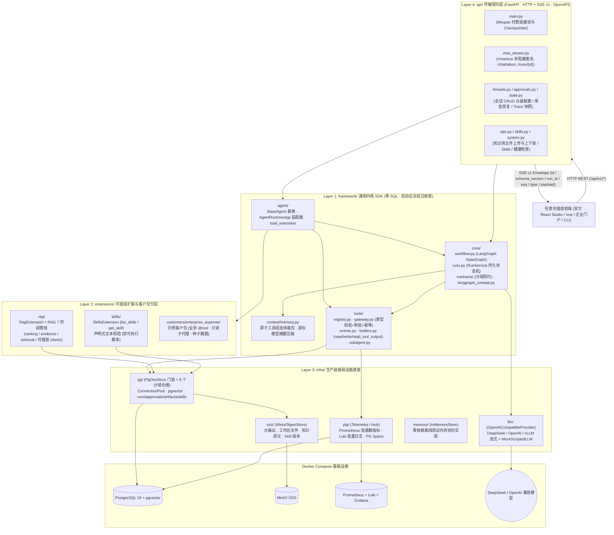
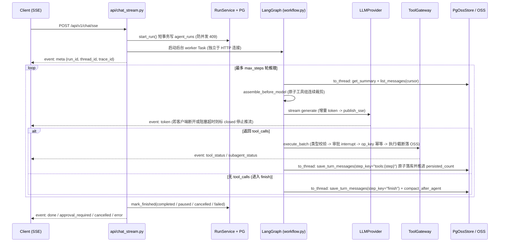
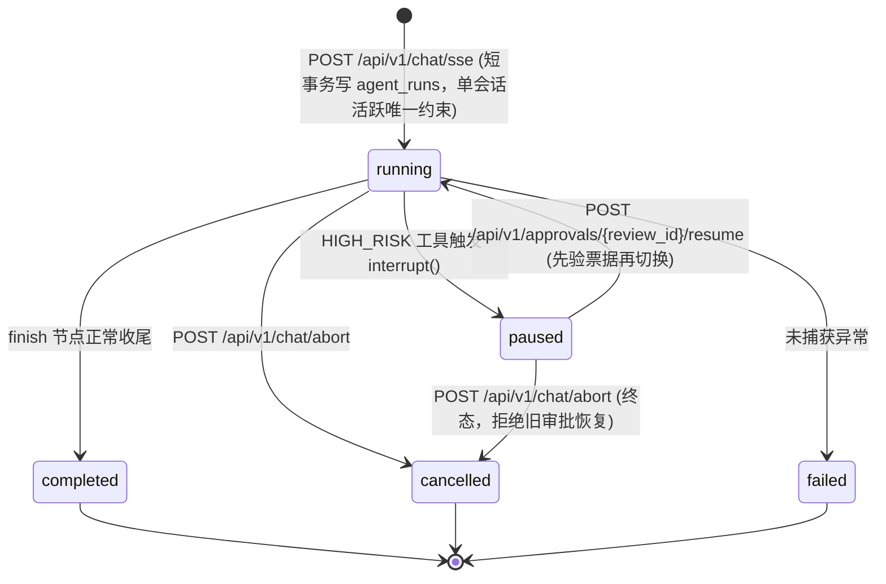

# `agent_runtime` 后端架构设计文档（v1.0）

> **包根路径**：`backend/agent_runtime/`（统一对外导入：`from agent_runtime import ...`）  
> **定位**：面向研发团队共享的企业级 **通用 Agent Runtime SDK + 生产级基础设施底座（PG / OSS / PLG / LLM）+ 可插拔能力扩展层 + 标准 HTTP / SSE v1 协议层**。

---

## 1. 四层总体架构

系统按**依赖单向收敛、职责细粒度拆包**原则划分为四层，核心引擎层（`framework/`）不写任何原始 SQL，也不耦合具体客户业务或前端框架：

---

## 2. 单轮对话执行与持久化时序

---

## 3. Run 生命周期与流式 Abort 状态机

系统放弃了跨长连接持有 PG Advisory Lock 的做法，改用 `agent_runs` 持久表 + 进程内取消信号协同，保证流式输出期间随时可安全中止，且已取消的 Run 不可被滞后审批复活：

---

## 4. 模块职责与文件映射

所有核心模块按单一职责控制在 ~200 行量级，避免大文件堆积：

| 层级 | 目录 / 文件 | 核心职责 |
| :--- | :--- | :--- |
| **Layer 1 · 装配** | `framework/agent/app.py`, `base.py` | `AgentRuntimeApp` 统一装配内核、扩展、冻结 `ToolRegistry`、`execute_run_state` 与 `resume_approval` 唯一编排入口；`BaseAgent` 声明式继承基类 |
| **Layer 1 · 内核** | `framework/core/workflow.py`, `runs.py`, `config.py`, `middleware.py`, `protocols.py`, `approval_rules.py` | 无 SQL 的 LangGraph `StateGraph` 编排；`RunService` 持久状态机与本地 TTL 节流；非阻塞 `publish_sse`；中间件链与公开扩展协议；审批票据校验纯规则 |
| **Layer 1 · 契约与图** | `framework/core/contracts/{identity,messages,runtime,artifacts}.py`, `langgraph_compat.py`, `mini_graph.py` | 零依赖 dataclass 契约；自动选择真 `langgraph`（+ `InMemorySaver` / `AsyncPostgresSaver`）或离线 `MiniStateGraph` |
| **Layer 1 · 上下文** | `framework/context/memory.py` | 前缀缓存友好组装、原子工具组连续裁剪（遇超限即 `break`，最新单组超限安全截断 `tool` 内容）、游标式模型摘要压缩 |
| **Layer 1 · 工具** | `framework/tools/{registry,gateway,events,builtins,decorator,subagent}.py` | 不可变内置工具保护与启动冻结；JSON Schema 参数类型校验（拦截 `bool` 冒充 `int`）、审批拦截、`op_key` 幂等、截断落 OSS；`@tool` 装饰器；只读子 Agent（`max_depth=1`） |
| **Layer 2 · RAG** | `extensions/rag/{models,clients,ranking,evidence,retrieval,text_utils,extension}.py` | 内置 RAG 7 阶段检索（Sparse/Dense 召回 → RRF → 邻接 Child 扩展 → 每文档上限 2 多样化 → Rerank 含降级 → 终排融合 → 无分数父证据聚合），支持 `tool` / `auto_inject` / `both` 与自定义 `RAGStrategy` |
| **Layer 2 · Skills** | `extensions/skills/extension.py` | PG 目录 + 不可变 OSS 版本；暴露 `list_skills` / `get_skill` 只读工具；上传边界拦截可执行脚本（`.py`/`.sh`/`.exe` 等） |
| **Layer 2 · 示例包** | `extensions/customers/enterprise_expense/` | 独立客户交付示例（BI/OA `@tool`、只读 `call_bi_analyst` 子代理、种子文档与 SOP Skill、离线演示脚本） |
| **Layer 3 · PG 仓储** | `infra/pg/{base,sessions,runs,approvals,artifacts,skills,rag_repo,ops_queries,postgres}.py` | `PgBase` 托管 `psycopg_pool.ConnectionPool`；按 8 个业务子域拆分的仓储 Mixin，由 `PgOssStore` 薄门面组合 |
| **Layer 3 · 其他底座** | `infra/oss/minio.py`, `infra/plg/{telemetry,hub}.py`, `infra/llm/{provider,mock}.py`, `infra/memory/` | MinIO S3 客户端；Prometheus 低基数指标 + Loki 异步批量推送；OpenAI 兼容流式 Provider；零依赖线程安全 `InMemoryStore` |
| **Layer 4 · API** | `api/{main,deps,schemas,system,threads,chat_stream,approvals,state,skills,ops}.py` | `/api/v1/*` 规范路由（含隐藏 `/api/*` 兼容别名），零内联 SQL，提供会话级联删除、文件上传、知识库与 Skill 生效/下架热切换 |

---

## 5. 生产级可靠性与安全红线

1. **SSE 断连防死锁与不丢字策略**
   - `chat_stream.py` 在 `stream()` 中轮询 `req.is_disconnected()` 并在 `finally` 标记 `closed = True` 同时唤醒队列；`publish_sse` 仅在队列满时有限等待（0.5s），超时自动将 sink 标记 `closed = True` 退出推流而不静默丢弃单条 token。
   - 后台 `worker` 脱离断开的 HTTP 连接继续执行完毕并落库，确保 `agent_runs` 必然收敛至终态，彻底杜绝会话永久 `409` 锁死。
2. **上下文原子工具组连续裁剪**
   - `assemble_before_model` 将每条 `assistant(tool_calls)` 与对应全部 `tool` 结果视为不可分割的原子组，从最新组向前累计预算，遇到首个放不下的旧组立即 `break`，保证发给真实 OpenAI / DeepSeek API 的消息序列严格连续且绝无孤立 `tool_call`。
   - 若当前最新单个工具组本身超过预算，优先对组内超长 `tool.content` 二分截断并保留完整配对。
3. **按步原子幂等持久化与同批次中断保副作用**
   - `tools_node` 在全部工具执行完毕后即刻按 `(thread_id, trace_id, step_key="tools:{step}")` 原子落库本步配对，并推进 `state["persisted_count"]`，下一轮 `before_model` 仅拼接 `history + pending[persisted_count:]` 防止重复喂给模型。
   - 若同批次多工具（如 `[write_tool, slow_tool]`）在第二个工具处被 `Abort` 取消，`execute_batch` 通过 `completed_sink` 保留已完成工具的结果，`tools_node` 捕获 `CancelledError`（绝不捕获 `GRAPH_INTERRUPT_TYPES`）为未完成 call 补齐 `[cancelled]` `tool` 消息并同步落库，避免“写工具副作用已发生但历史失忆”。
4. **高危审批与单动作幂等键**
   - `op_key` 绑定 `(thread_id, user_id, request_id, tool_name, tool_call.id)`，同一轮合法多次写操作互不撞键；网关通过 `ctx.op_key` 透传给业务 handler，确保业务表与 `tool_runs` 幂等键完全一致。
   - 真实 LangGraph 恢复 `interrupt()` 时会从头重放 `tools_node`，此前同批次已完成的 `WRITE` 工具命中 `tool_runs` 缓存直接回放，绝不二次执行副作用。
5. **非阻塞异步热路径与连接池**
   - `PgBase` 使用 `psycopg_pool.ConnectionPool`（在 FastAPI `lifespan` 中统一打开与关闭），async 图节点与关键路由通过 `asyncio.to_thread` 卸载同步 IO；`RunService.is_cancelled` 优先读取进程内取消标记并对 DB 轮询做 0.5s TTL 节流。
6. **云原生并发写保护与热上下架**
   - 工作区文件与 Skill 版本均采用唯一不可变 OSS 对象键（`uid` / `version_id`），先写 OSS 再在 PG 事务内原子递增版本号（`version + 1` / `FOR UPDATE`），避免并发写覆盖同一对象。
   - 知识库文档（`PATCH /api/v1/knowledge/{parent_id}/status`）与 Skill（`PATCH /api/v1/skills/{slug}/status`）支持 `active` / `disabled` 实时切换，下架后立即停止被 RAG 召回或被 Agent 发现调用。
7. **架构边界与当前阶段说明**
   - **同进程扩展边界**：内置工具（`read`/`write`/`read_tool_output`）保护与启动后 `ToolRegistry.freeze()` 属于**工程解耦与防误覆盖边界**，同进程加载的 Python `AgentPlugin` 共享进程内存，不构成针对不可信恶意代码的 OS 沙箱。
   - **默认身份约定**：当前基础服务默认采用统一基础权限，并信任上游内网网关传入的身份头（`X-Tenant-Id` / `X-User-Id`）；若需对外网开放或多租户强隔离，应在接入层 API 网关完成 JWT/OAuth 校验后再透传。

---

## 6. 业务扩展方式

下游团队无需改动 `framework/` 内核，按需选择以下 4 种标准接入方式：

1. **挂载单个业务工具**：使用 `@tool(risk_level=...)` 装饰函数，自动生成 JSON Schema 与 `ctx: ExecutionContext` 注入。
2. **交付领域扩展包**：继承 `AgentPlugin`，通过 `AGENT_EXTENSIONS=module.path:ClassName` 动态装配工具、只读子 Agent、中间件、提示词片段与种子数据。
3. **定制主 Agent 模板**：继承 `BaseAgent`，声明 `system_prompt`、`build_tools()`、`build_subagents()`、`build_middlewares()`，直接调用 `.build_app()` 生成完整运行时。
4. **替换检索策略**：向 `RagExtension` 注入自定义 `EmbeddingClient` / `RerankClient`（保留内置 RAG 7 阶段管线），或直接传入实现 `RAGStrategy` 协议的外部检索引擎（Milvus / ES / GraphRAG 等）。
