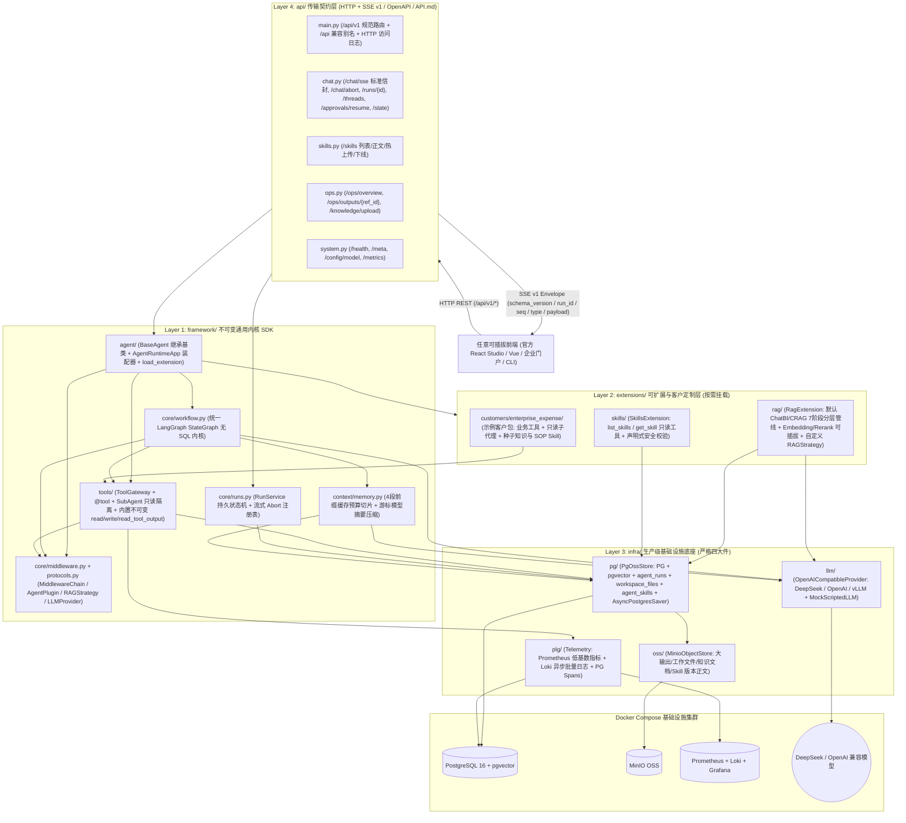
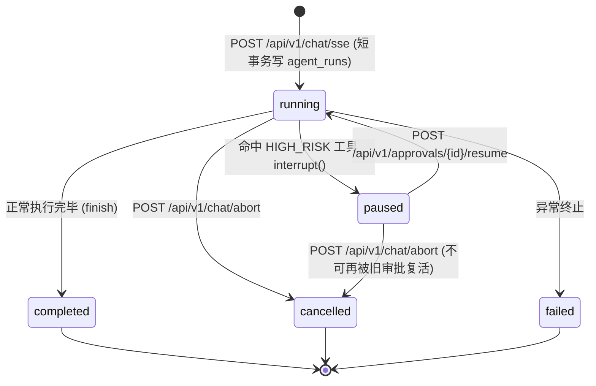

# `agent_runtime` 四层架构设计图（v1.0 定稿）

> 对应包根：`backend/agent_runtime/`（对外统一导入 `from agent_runtime import ...`）
>
> 定位：**内部研发团队统一共享的核心 SDK + 完整生产级 Infra（PG / OSS / PLG / LLM）+ 按客户插拔的扩展层 + 可替换前端协议层（HTTP / SSE v1）**。

---

## 1. 四层总体架构图

---

## 2. Run 生命周期与流式 Abort 状态机

---

## 3. 核心设计约束与边界说明

1. **内置工具防误覆盖边界（非恶意代码沙箱）**：`read`、`write`、`read_tool_output` 为云原生内置工具（全跑在 PG + OSS 上，零本地磁盘依赖）；启动后冻结 `ToolRegistry` 防止同进程扩展意外覆写或运行期篡改。注意：同进程 Python 插件共享宿主进程内存，属于**工程解耦与防误覆盖边界**，不构成针对不可信恶意 Python 代码的 OS 沙箱。
2. **默认身份约定**：当前基础服务默认采用统一基础权限，并信任上游内网网关传入的身份头（`X-User-Id` / `X-Tenant-Id`）；若对外暴露服务，需在接入层网关统一完成 JWT / OAuth 鉴权再透传身份头。
3. **单动作幂等键**：写工具 `op_key` 绑定持久化的 `tool_call.id`，一轮合法多次 `write` 互不撞键，同动作篡改参数重放立即触发 `op_key_conflict`。
4. **Agent as Tool 多智能体**：默认单主 Agent 开箱即用；通过 `SubAgentProfile` 可按需挂接任意数量只读子代理（`max_depth=1`、`allow_write=False`、私有窗口隔离、并发执行）。
5. **声明式 Skills 安全红线**：Skills 存 `agent_skills` + 不可变 `agent_skill_versions` + OSS；热上传先写 OSS 再切 PG 指针，严禁上传可执行脚本文件（可执行能力必须走受审 Python 插件）。
6. **CRAG 7 阶段检索管线（对齐 ChatBI/rag-retrieval）**：严格分层类型（`SparseSearchResult → DenseSearchResult → RrfFusionResult → 相邻 Child 扩展 → CandidateDiversifier(每文档上限2) → RerankService + FinalRankFusionService(k=60, w=0.8) → ParentEvidenceResult`）；`retrieve_chunks()` 输出 4 阶段独立得分供诊断评估，`retrieve_evidence()` 输出无分数的父级证据供 LLM 消费；支持可插拔 `EmbeddingClient` / `RerankClient` 或传入自定义 `RAGStrategy`。
