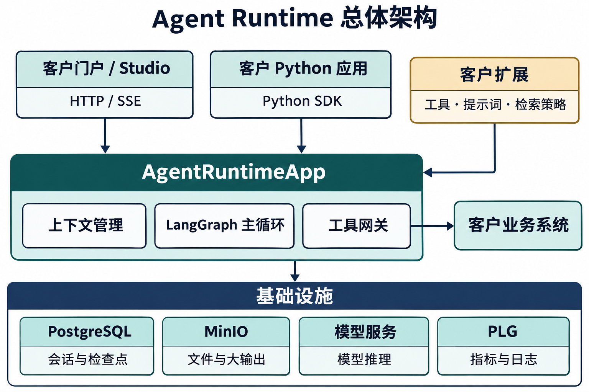
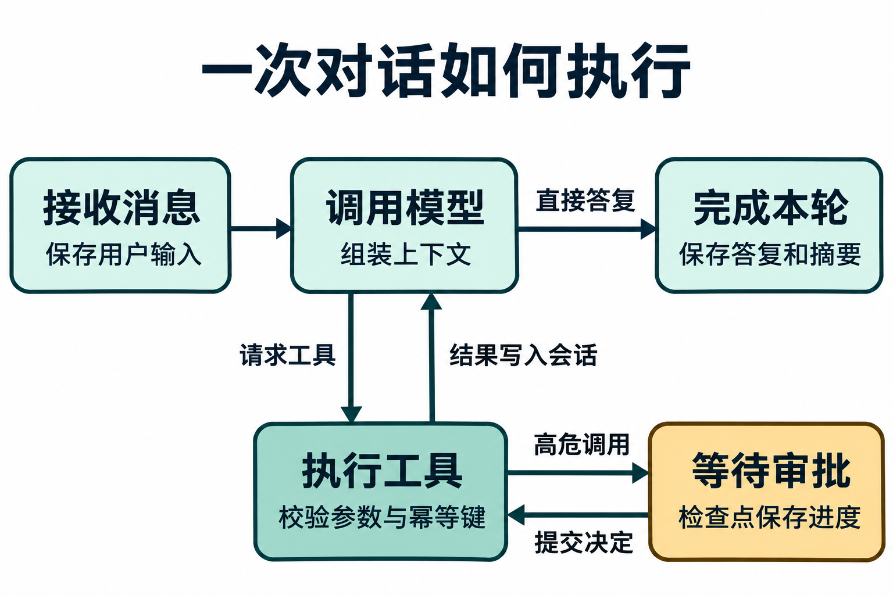

# Agent Runtime · 后端架构

客户代码决定 Agent 能办什么事。共享 SDK 负责一轮对话怎样运行、调用工具后怎样继续，以及中途暂停后从哪里恢复。Python 应用可以直接装配 SDK，参考 HTTP 服务则把同一条执行路径开放给 Studio 和客户门户。

[项目首页](../README.md) · [HTTP / SSE v1 契约](API.md) · [后端源码](../backend/agent_runtime/)

---

## 1. 总图、分层边界与装配生命周期

### 三层职责与依赖约定

| 层 | 负责什么 | 从哪里读代码 |
| --- | --- | --- |
| 接口 (`api/`) | 接收 HTTP 请求，解析身份，启动/恢复运行，通过 SSE v1 推流（不内置管理后台，管理面由客户应用自建） | [api/main.py](../backend/agent_runtime/api/main.py) · [chat_stream.py](../backend/agent_runtime/api/chat_stream.py) |
| 内核 (`framework/`) | 装配模型与客户插件，构建执行图，管理上下文预算、Run 状态机、安全契约、工具网关，以及 `SkillProvider` / `RagProvider` 薄 Harness 适配 | [agent/app.py](../backend/agent_runtime/framework/agent/app.py) · [core/workflow.py](../backend/agent_runtime/framework/core/workflow.py) · [tools/skills.py](../backend/agent_runtime/framework/tools/skills.py) · [tools/rag.py](../backend/agent_runtime/framework/tools/rag.py) |
| 基础设施 (`infra/`) | 适配核心 PostgreSQL、MinIO 对象存储、OpenAI 兼容 LLM 服务与 PLG 观测 | [PG](../backend/agent_runtime/infra/pg/) · [OSS](../backend/agent_runtime/infra/oss/) · [LLM](../backend/agent_runtime/infra/llm/) · [PLG](../backend/agent_runtime/infra/plg/) |

**依赖方向与客户隔离原则：**
- 依赖方向严格单向 `api -> framework <- infra`（由 AST 验收测试守护）：SDK 内核不内置任何 RAG/Skills 存储实现，不依赖 `pgvector`，也不创建 RAG/Skills 表或文档级 SQL ACL 逻辑。
- [费用示例](../examples/enterprise_expense/) 作为独立 Python 包依赖 SDK。插件通过 `register_tools()` 声明业务工具、通过 `subagents()` 声明 `SubAgentProfile`、通过 `skill_provider()` / `rag_provider()` 接入自有 SOP 与知识检索（含客户自定义权限过滤），并在 `bootstrap_store()` 创建 OA 表。
- 扩展按需提供 `routers()` 与 `bootstrap_store()`；核心 `deploy/sql/` 只包含执行底座表（并内置幂等迁移 `006_drop_tenant_id.sql`，带冲突预检，安全保留历史审批与 OSS 路径）。

### 启动装配 vs 每次执行

1. **启动装配（一次）**：`AgentRuntimeApp` 构造 → 注册不可变内置工具（`read` / `write` / `read_tool_output`）→ 加载自定义工具、`subagents`、`skill_provider` / `rag_provider` 与 `extensions`（自动发现 `ext.skill_provider()` / `ext.rag_provider()` 并注册 `list_skills` / `get_skill` / `search_knowledge` 与受控中间件；自动装配 `ext.register_tools()`、`ext.subagents()`、`ext.middlewares()`；HTTP 层按需挂载 `ext.routers()`）→ **冻结 `ToolRegistry`**（运行期禁止篡改工具表）→ 执行幂等 `bootstrap_extensions()`。
2. **每次执行（按请求）**：SDK 与 HTTP 共用 `prepare_turn_run` / `execute_run_state` / `abort_run` / `resume_approval` → 校验创建者会话归属 → 登记持久化 `agent_runs`（每次 Run 独立占用以 `run_id` 为键的 LangGraph 检查点，取消待审批 Run 后原会话立即可继续新对话）→ 流式推送 SSE v1 事件并按步落库。

> **同进程运行边界**：客户 Python 插件与后端运行在同一进程内，应按业务代码同等级评审、打包与发布，更新后重启服务生效。

---

## 2. 一轮请求：模型决定下一步，Runtime 负责执行

以费用示例“核查差旅超标并发起审批”为例。Python SDK（`app.run_turn` / `app.resume_approval`）与 HTTP 服务共用以下单一 LangGraph `StateGraph` 执行图：

1. **组装上下文（`before_model`）**：读出历史摘要与摘要游标之后的消息，拼接当前轮尚未持久化的临时消息。预算超限时以**原子工具组**（`assistant(tool_calls)` + 对应全部 `tool` 结果）为单位从旧到新连续裁剪；若最新一组自身超窗则截断工具正文而非丢弃配对，避免模型看到孤立的 `tool_call`。[上下文组装](../backend/agent_runtime/framework/context/memory.py)
2. **执行工具（`tools_node` → `ToolGateway`）**：按 `RiskLevel` 分流（只读工具受限并行，写/高危工具串行），依次执行权限收窄校验、JSON Schema 参数校验、循环熔断、高危审批拦截、幂等抢占与超时控制。返回过大时将原文落 MinIO，仅把预览与 `ref_id` 放回上下文，由 `read_tool_output` 分页续读。[工具网关](../backend/agent_runtime/framework/tools/gateway.py)
3. **按步记录进度**：每批工具完成后，图节点以 `(thread_id, trace_id, step_key)` 幂等写入本批消息并推进 `persisted_count`。最终答复在 `finish` 落库后即可返回。后台按 `H = 模型窗口 − 固定指令与工具定义 − 动态注入预留 − 提问缓冲 − 输出预留` 计算历史预算。旧摘要与未压缩消息超过 70% × H 时，按完整用户轮次切分，目标保留约 20% × H 的近期原文，仅推进摘要游标。模型调用前若估算超限，先复用在途摘要、移除动态注入、折叠旧工具预览，再按需同步压缩历史；始终保留当前提问，单次提问过长会提示分段。短生命周期的 Python 程序可在退出事件循环前 `await app.compactor.drain()` 等待回写。[执行图](../backend/agent_runtime/framework/core/workflow.py)
4. **跨轮审批恢复**：`HIGH_RISK` 工具通过 LangGraph `interrupt()` 暂停，前端收到 `approval_required`。提交决定后，服务校验检查点挂起票据与运行状态，记录决定并以 `Command(resume=review_id)` 恢复同一检查点继续执行。[审批入口](../backend/agent_runtime/api/approvals.py) · [运行状态](../backend/agent_runtime/framework/core/runs.py)

---

## 3. 状态归属、存储分工与标识串联

核心标识关联：`request_id`（客户端请求关联标识，并参与写动作 `op_key` 计算）→ `run_id`（一次运行生命周期，受同会话活跃唯一约束保护，同时作为 LangGraph 检查点隔离键）→ `trace_id`（单轮观测链路，校验所属会话创建者）→ `op_key`（基于会话、用户、请求、工具名与 `tool_call.id` 计算的写动作幂等键）→ `thread_id`（会话归属与消息历史主键）。

| 问题 | 去哪里查（存储层） | 关联键 / 前缀 |
| --- | --- | --- |
| 这次对话写入了哪些消息与摘要？ | PG：`agent_threads`、`session_messages`、`session_summaries` | `thread_id` |
| 当前在执行、等审批还是已取消？ | PG 业务状态：`agent_runs`、`tool_approvals`；LangGraph 断点：`checkpoints*` | `run_id` / `review_id` / `thread_id` |
| 同一个写动作是否执行过？ | PG：`tool_runs`（记录 `running`/`done`/`reconcile`、回执与结果引用） | `op_key` |
| 原始大输出、工作区原文在哪？ | 核心 PG 存 `tool_outputs`、`workspace_files`；MinIO 存不可变原文 | `outputs/`、`workspaces/` |
| 哪一步拖慢了响应？ | Prometheus（首 token / 工具状态）、Loki（结构化日志）、PG `agent_spans`（步骤耗时）、Grafana 看板 | `trace_id` |

**检查点与连接生命周期**：
- FastAPI `lifespan` 启动时打开 `psycopg_pool.ConnectionPool`（`PgOssStore`）、初始化 `AsyncPostgresSaver`、装配 `OpenAICompatibleProvider` 与后台日志推送协程，关闭时优雅刷盘并释放连接池。[启动与关闭](../backend/agent_runtime/api/main.py) · [PG 仓储](../backend/agent_runtime/infra/pg/postgres.py)
- 直接嵌入 Python SDK 时，默认检查点为进程内 `InMemorySaver`；需要跨进程或跨重启恢复审批时，应显式传入持久化 checkpointer（如 `AsyncPostgresSaver`）。

---

## 4. 断连、取消、重放与故障窗口

| 情况 | 当前后端行为 | 客户开发 / 运维需要知道什么 |
| --- | --- | --- |
| 浏览器关闭、刷新或 SSE 消费过慢 | `RunEventBroker` 按 `run_id` 保留有界事件环形缓冲（默认 512 帧 / TTL 5 分钟），慢消费者自动摘除不再阻塞后台协程 | 后台运行继续收敛并落库，不会锁死会话 409；客户端断线重连可携带 `Last-Event-ID` 调用 `GET /api/v1/runs/{run_id}/events` 断点补帧 |
| 用户在一批工具执行中途取消 | `tools_node` 捕获 `CancelledError`（不吞 LangGraph 中断异常），同步刷盘本批已完成结果并为未完成调用补 `[cancelled]`；`agent_runs` 不可逆置为 `cancelled`，拒绝迟到的审批恢复 | 已被下游业务系统受理的副作用仍需按业务规则补偿或人工核对 |
| 审批恢复触发节点重放 | 网关用 `op_key` 抢占；已完成写动作直接复用已存回执，避免重复扣款或重复提单 | 对接真实 OA / 工单时，务必透传 `ctx.op_key` 给下游做幂等防重 |
| 下游已受理但超时/中途取消（状态不确定） | 网关将 `tool_runs.status` 标记为 `reconcile`；若工具通过 `@tool(reconcile=...)` 注册了对账回调，重放或调用 `gateway.reconcile_tool_run()` 时自动按 `op_key` 查单收敛为 `done`/`failed`，避免重复写入 | 客户连接器按需提供 `reconcile(op_key, args, ctx) -> ReconcileResult` 查单对账回调 |
| 进程崩溃或异常退出遗留活跃 Run | `RunService` 在任务执行期间定期刷新 `agent_runs.updated_at` 心跳租约；启动时与同会话发生并发冲突时自动回收超期僵尸 `running` Run（标记为 `failed/stale_run_recovered`，**永不误杀 `paused` 待审批 Run**） | 可通过 `AGENT_STALE_RUN_TIMEOUT_SEC`（默认 `120` 秒）调整租约回收阈值 |

---

## 5. 扩展契约：从费用示例换成客户项目

| 扩展协议 | 定位与适用场景 | 源码入口 |
| --- | --- | --- |
| `AgentPlugin` | 统一的能力包与客户业务打包入口（声明系统提示词、工具、子 Agent、`skill_provider`、`rag_provider`、受控中间件、可选路由与前端元信息），支持 `extensions=[...]` 与 `AGENT_EXTENSIONS` 挂载 | [core/protocols.py](../backend/agent_runtime/framework/core/protocols.py) |
| `SkillProvider` | 极薄的 Skill 加载口子：`list_skills(scope, query)` 与 `get_skill(scope, slug, resource)`（同步/异步均可）。SDK 自动装配 Layer-1 目录注入（Prefix Cache 稳定）与按需正文读取工具，完全不干预存储与权限实现 | [core/protocols.py](../backend/agent_runtime/framework/core/protocols.py) · [tools/skills.py](../backend/agent_runtime/framework/tools/skills.py) |
| `RagProvider` | 极薄的知识检索口子：`retrieve(scope, query, top_k, ctx)`（同步/异步均可）。SDK 自动装配 `search_knowledge` 工具（可选预算受控自动注入）与 `[1]` 编号引文规范，完全不干预向量库/检索引擎与文档级权限实现 | [core/protocols.py](../backend/agent_runtime/framework/core/protocols.py) · [tools/rag.py](../backend/agent_runtime/framework/tools/rag.py) |
| `AgentMiddleware` | 受控生命周期切面（`extra_context` 纳入内核预算、`transform_user_input`、`on_before_model` 只读快照、`after_model`、`wrap_tool`、`after_turn`），不可破坏上下文裁剪与工具配对 | [core/middleware.py](../backend/agent_runtime/framework/core/middleware.py) |
| `LLMProvider` | 替换模型后端（默认 OpenAI 兼容流式 Provider，当前接入 DeepSeek，预留多 API 扩展） | [infra/llm/provider.py](../backend/agent_runtime/infra/llm/provider.py) |

| 新客户需求 | 推荐接入方式 |
| --- | --- |
| 接入新业务系统（ERP / 工单 / OA） | 用 `@tool` 封装客户接口并标注 `RiskLevel`，通过独立客户包注册，由网关统一处理校验、超时、审批与幂等 |
| 接入客户知识库 / 向量检索 | 实现 `RagProvider` 对接 Milvus / ES / Dify / 客户内部检索服务，并在 `retrieve()` 内使用 `scope` 执行客户自有文档权限过滤 |
| 接入业务 SOP / Skills | 实现 `SkillProvider` 对接本地目录、Git、数据库或客户门户，并在 `list_skills()` / `get_skill()` 内使用 `scope` 执行客户自有权限过滤 |
| 接入现有门户前端 | 对接 [HTTP / SSE v1 契约](API.md)，与参考 Studio 共用同一后端与运行状态 |

---

## 6. 安全边界与可拔插 ACL 架构

> 核心安全契约见 [security/](../backend/agent_runtime/framework/core/security/)。SDK 只负责 Harness 层点查鉴权（会话、审批、工具、工件与模型配置）；知识库文档级与 Skill 级数据权限完全下放给客户自己的 `RagProvider` / `SkillProvider` 实现，避免把五花八门的 RBAC/ABAC/部门树/行级 SQL 过滤拖进 SDK 内核。

### 6.1 可拔插双协议与单部署边界

业务路由、LangGraph 节点与工具网关统一调用两个最小协议，内核已移除 `tenant_id`，每个客户独立部署只需提供可信的 `user_id`：

| 协议 | 职责与最小签名 | 内置实现与环境变量 |
| --- | --- | --- |
| `IdentityResolver`（认证 AuthN） | `resolve(context) -> AuthScope` | `StaticIdentityResolver`（`default`）、`HeaderIdentityResolver`（`header` / `signed_header`，对 `["v1", user_id, roles]` 做 HMAC 验签，忽略遗留 `X-Tenant-Id`）或自定义 `module:Symbol`（`AGENT_IDENTITY_RESOLVER`） |
| `AccessController`（授权 AuthZ） | `check(scope, action, resource) -> AccessDecision` `policy_rev(scope) -> int` | `RbacAccessController(admin_roles=None)`（`default`）、`NoopAccessController`（`noop`）、`RbacAccessController(admin_roles=..., platform_admin_roles=...)`（`rbac`，可配 `AGENT_APPROVER_ROLES` / `AGENT_FORBID_SELF_APPROVAL`）或自定义 `module:Symbol`（`AGENT_ACCESS_CONTROLLER`） |

**四项永不关闭的内核安全不变量**（即使在 `default` 或 `noop` 模式下也始终生效）：
1. **创建者硬归属隔离**：`thread_id`、`run_id`、`trace_id`、`ref_id` 与工作区文件统一在核心仓储和 `RunService` 按 `actor_id == scope.user_id` 强制拦截（不匹配一律 `404`）。
2. **审批默认仅限创建者，跨人审批需显式授权**：默认模式与 `noop` 模式下，其他用户即使拿到 `review_id` 也无法批准/恢复他人会话；仅当客户显式配置 `approver_roles`、显式 `admin_roles` 或自定义 `AccessController` 时才允许跨人审批。
3. **审批原子性与写幂等**：高危动作按 `review_id` 消费不可重放、写动作按 `op_key` 去重；SDK 与 HTTP 共用的 `resume_approval` 强制以可信主体 `caller.user_id` 署名。
4. **子 Agent 权限单调收窄与及时取消**：`AuthScope.allowed_tools` 区分 `None`（不限）与 `()`（零权限），父子工具求交为空时目录与执行双拒绝；子 Agent 每步入口实时响应 `check_cancelled()`。

**已落地的核心策略规则**：
- **Fail-Closed**：任意 `AccessController` 抛异常或返回非法对象时一律 fail-closed（HTTP 返回 `503`，工具返回 `acl_error`）。
- **数据层权限完全客户自治**：SDK 将已验签的 `scope: AuthScope`（含 `user_id`、`roles`、`attrs`）透传给 `RagProvider.retrieve()` 与 `SkillProvider.list_skills()` / `get_skill()`，由客户按自身权限模型（RBAC、ABAC、OPA、部门树或调用下游带鉴权的检索接口）自行裁决。
- **动态 `policy_rev` 失效保护**：`workflow.run_context` 每次节点进入实时读取 `access_controller.policy_rev(scope)`，暂停期间策略版本递增后，恢复消费自动因 `approval_mismatch` 拒绝执行。

### 6.2 全链路受控资源矩阵

| 资源域 | 覆盖动作 | 归属与执行方式 |
| --- | --- | --- |
| HTTP / SDK 入口 | 主体解析与验签 | SDK 内置 `default` / `header` / `signed_header`（`["v1", user_id, roles]` HMAC 验签失败返 `401`）及自定义解析器 |
| Thread / Run / Trace | 创建、列表、历史、状态快照、中止、删除 | SDK 在 PG 查询与 `RunService` 强制 `actor_id == scope.user_id` 归属（含仅传 `trace_id` 访问 `/state`） |
| Approval | 审批决定、恢复消费 | SDK 与 HTTP 均按 `caller.user_id` 署名，默认仅创建者可批，支持 `approver_roles`、`forbid_self_approval` 与 `policy_rev` 复核 |
| Tool | `/meta`、主图与子 Agent 可见目录及网关执行 | 目录过滤与执行强拦双一致，主循环与子 Agent 共用 `model_step.py` 单步调用助手 |
| Artifact / Workspace | HTTP 与 `read_tool_output` 分页续读、文件读写 | SDK 统一校验 `resource_owner == scope.user_id`、`artifact:read` 与 TTL |
| 模型配置 | `/config/model` | SDK 校验 `system:update_model`（`rbac` 模式下限定 `platform_admin`） |
| 知识库与 Skills（客户自治） | 检索、目录、正文与附件读取 | 客户在 `RagProvider` / `SkillProvider` 内基于透传的 `scope` 自行鉴权；SDK 仅负责工具封装、引文格式与上下文预算 |
